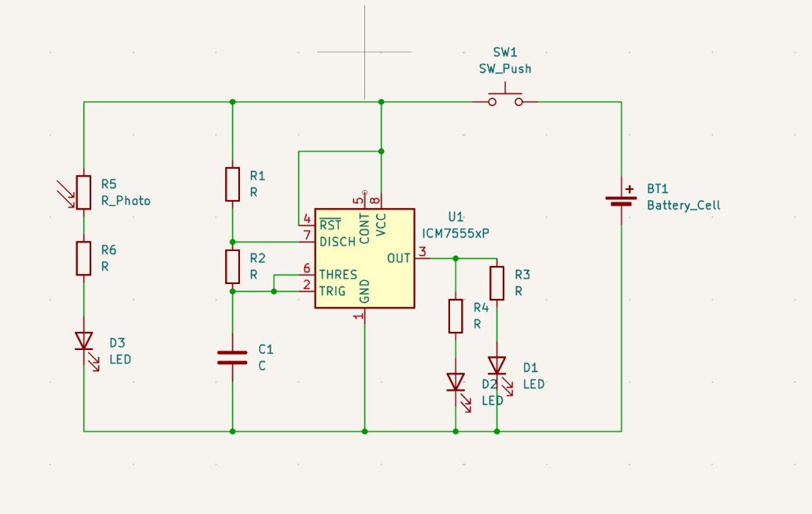
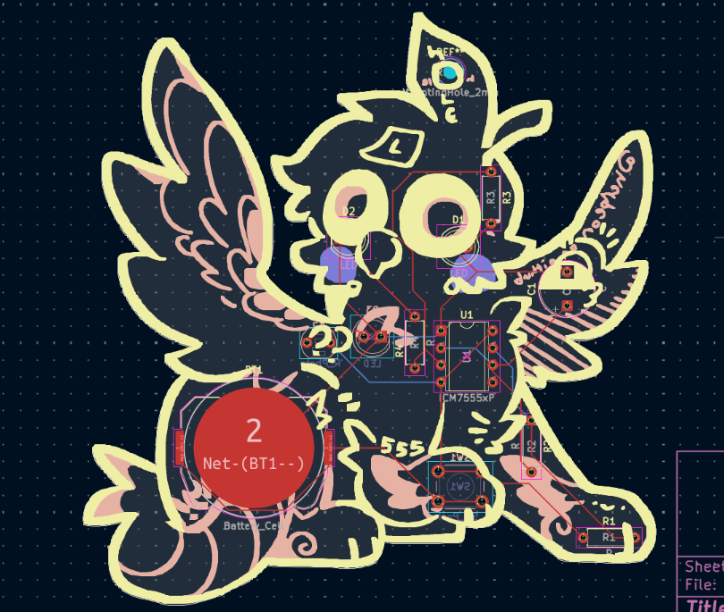
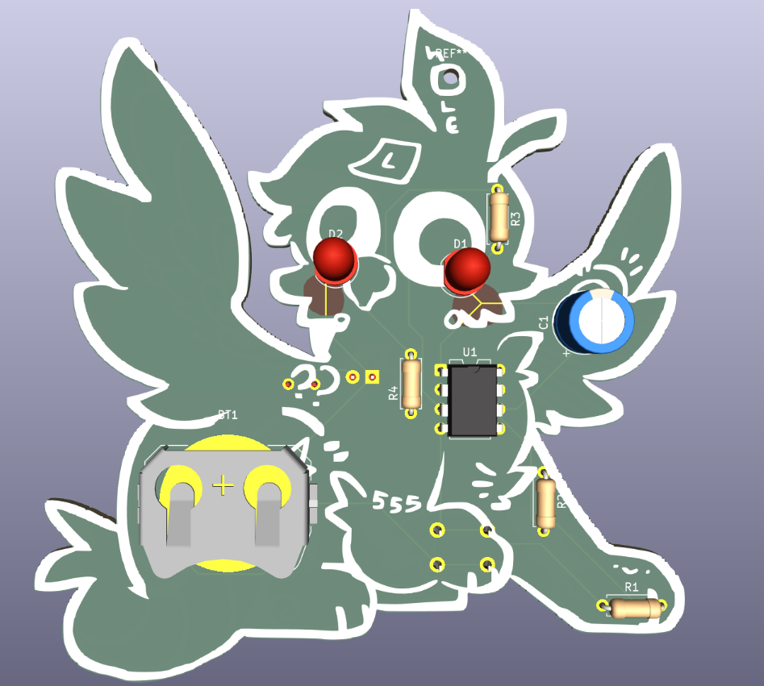
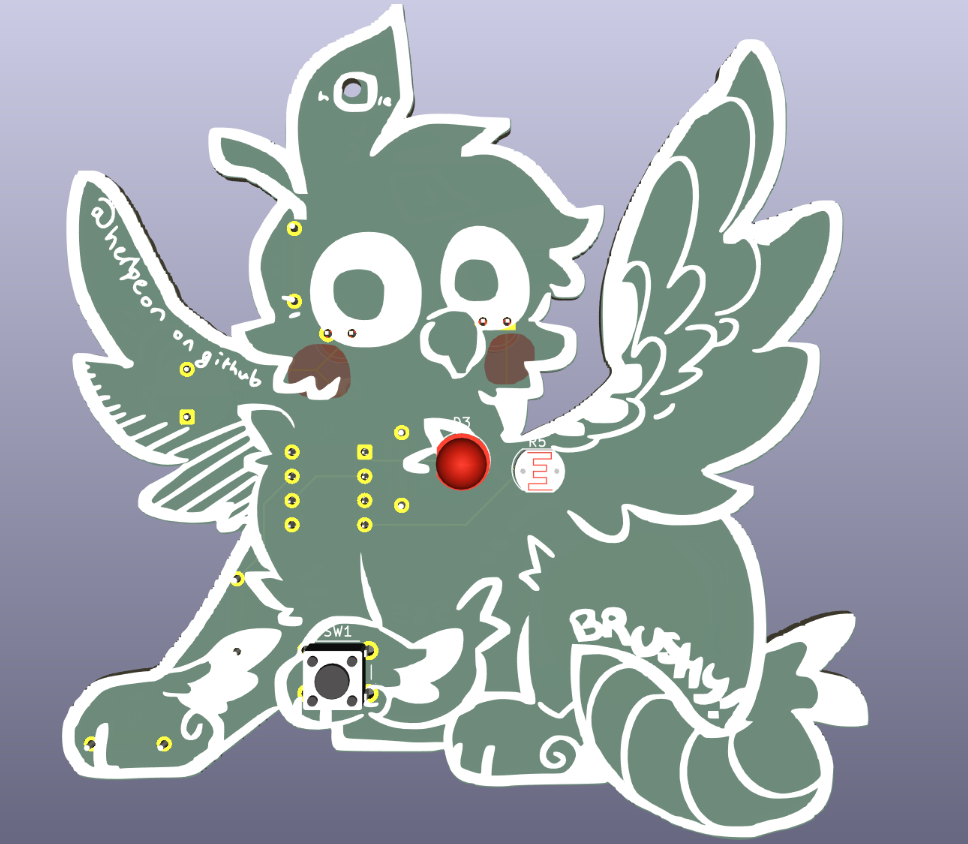

# pcbrushy
Pcb keychain of my bird (3.5 year old green cheek conure named Brushy). It's also my first PCB yay!!

# schematic

falstad simulation link: https://www.falstad.com/s.php?s=VXZuTE

# PCB

# features
* Since it was my first time I wanted to keep it simple
* the main thing is a 555 timer that flashes 2 LEDs
* There is also an LED + photoresistor so there's more light when it's...bright (I thought it went the other way around while I was making this oops)
* and a push button at the beginning of the circuit.
* Also has silkscreen art by me on Krita :D and a bit of FR4 art. didn't have time to figure out copper loll

I would have liked to add something to do with the motor (a lil buzz fidget or something) but that didn't happen rip. also the transistors are cool I just couldn't figure out what to do with them.

# BOM
| item | amount |
| :------- | ------: |
| 3V battery cell | 1 |
| 10 uF capacitor | 1 |
| 1k resistor | 2 |
| 4.7k resistor | 1 |
| 47k resistor | 1 |
| photoresistor | 1 |
| LED | 3 |
| push button | 1 |
| 555 timer | 1 |

made by Herby on slack for [Hack club solder!](https://solder.hackclub.com/)